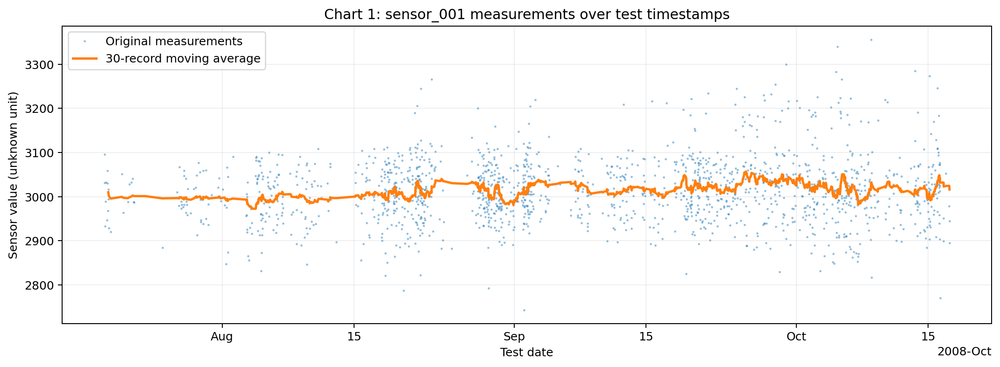
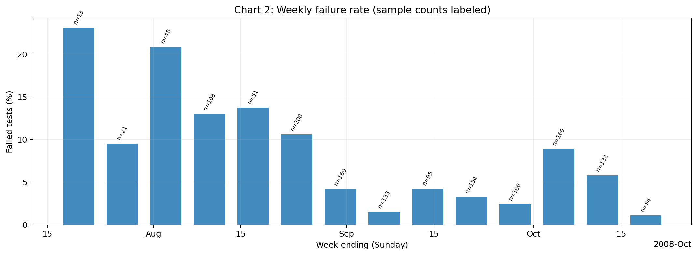
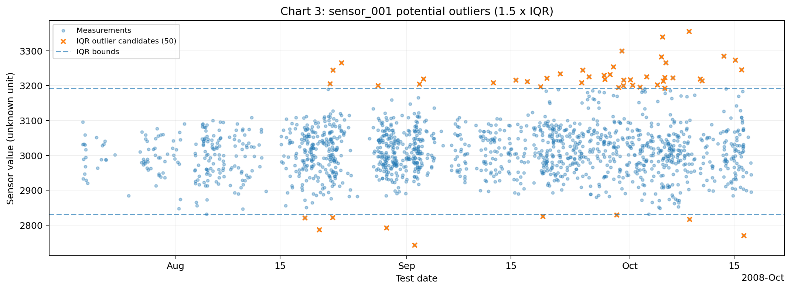
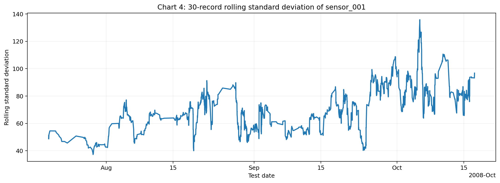

# 반도체 제조 공정 데이터의 시계열 분석을 통한 공정 안정성 및 불량 발생 패턴 탐색

> **프로젝트 요약**  
> UCI SECOM의 2008년 7~10월 검사 기록 1,567개와 익명 공정 측정 변수 590개를 대상으로, 선택한 측정변수의 시간적 변화, 주별 불량 판정률, 이상치 및 변동성을 탐색했다. 총 불량 판정은 104건(6.637%)이며, 대표 변수 `sensor_001`에서는 IQR 기준 이상치 후보 50건을 확인했다. 이는 **탐색 분석 결과**이며 공정 이상이나 불량의 인과관계를 입증하지는 않는다.

## 1. 분석 주제 및 선정 이유

반도체 제조 공정에서는 여러 측정값과 품질 검사 결과를 함께 살펴 공정 변화를 파악한다. 이번 분석은 실제 공개된 SECOM 데이터로 시간에 따라 검사 기록과 측정값이 어떻게 달라지는지 시각화하고, 품질관리(QC) 관점에서 추가 확인이 필요한 시점을 찾아보는 것을 목적으로 한다. 단순한 선 그래프 작성에 그치지 않고, **관찰한 사실–가능한 해석–후속 검증**을 분리한다.

## 2. 분석 질문

1. 선택한 공정 측정값은 검사 시각에 따라 어떤 흐름을 보이는가?
2. 최근 30개 기록의 이동평균과 이동 표준편차는 어떤 변화를 보여 주는가?
3. 주별 불량 판정률은 얼마나 차이가 나며, 주별 표본 수에 따라 어떻게 해석해야 하는가?
4. IQR 기준으로 특이한 측정값은 몇 건이고 언제 나타나는가?
5. 관찰된 변화만으로 설비 이상이나 불량 발생 원인을 판단할 수 있는가?

## 3. 데이터 출처·구성 및 품질 점검

| 항목 | 내용 |
|---|---|
| 출처 | McCann, M. & Johnston, A. (2008), *SECOM*, UCI Machine Learning Repository |
| 출처 링크 | https://archive.ics.uci.edu/dataset/179/secom |
| DOI | https://doi.org/10.24432/C54305 |
| 관측 범위 | **2008-07-19 11:55:00 ~ 2008-10-17 06:07:00** |
| 데이터 건수 | **1,567개 검사 기록** |
| 입력 측정 변수 | **590개** (익명화된 공정 측정 변수) |
| 품질 판정 | **정상(-1) 1,463건, 불량(1) 104건** |
| 전체 불량 판정률 | **104 ÷ 1,567 × 100 = 6.637%** |
| 전체 센서값 결측 | **41,951 / 924,530셀 = 4.538%** |
| 대표 분석 변수 | **`sensor_001`** (해당 변수의 결측 6개) |
| 대표 변수 통계 | 평균 **3014.4529**, 최솟값 **2743.24**, 최댓값 **3356.35** (단위 미공개) |

데이터 파일은 `secom.data`(590개 공정 측정값)와 `secom_labels.data`(검사 결과와 검사 시각)로 구성된다. 원본의 같은 행끼리 연결한 뒤 검사 시각을 날짜형으로 변환해 정렬하였다. 이 시각은 **제품 검사·기록 시각**이며 장비 센서의 일정 간격 연속 측정 시각임이 보장되지 않는다.

### 전처리와 결측치·이상치 기준

- **결측치:** `NaN`을 결측으로 인식했고, 임의 값으로 대체하거나 보간하지 않았다. 다른 제품/검사 기록 사이의 빈 값을 가짜 측정값으로 채우면 분포를 왜곡할 수 있기 때문이다. 이동평균·표준편차는 해당 창 안에 있는 유효 관측값을 대상으로 계산한다.
- **대표 변수 선정:** 데이터의 품질 라벨과 무관하게, 결측 비율이 낮고(관측 비율 95% 이상) 서로 다른 값이 20개 이상인 첫 변수를 선정하도록 코드를 작성했다. 실제 결과는 `sensor_001`이다. 이는 **불량 예측력이 가장 높은 변수라는 의미가 아니다.**
- **이상치:** 대표 변수의 전체 분포에 `Q1 − 1.5×IQR`와 `Q3 + 1.5×IQR` 기준을 적용했다. 하한 **2830.675**, 상한 **3192.235** 밖의 값 **50개**를 *이상치 후보*로 표시하고 삭제하지 않았다. 50개는 품질 검사에서 불량으로 판정된 104개와 다른 개념이다.
- **집계 단위:** 불량률은 **주별(일요일 종료 기준)**로 집계했고, 이동 통계는 **최근 30개 검사 기록**을 사용했다. 30일 또는 30분 단위 이동 통계가 아니다.

## 4. 분석 기법 및 적용 이유

1. **30개 기록 이동평균:** 개별 측정값의 산포를 완화해 평균 수준의 흐름을 살핀다.
2. **주별 불량률 집계:** 주별 `불량 건수 / 검사 건수 × 100`을 계산해 품질 판정 비율을 비교한다. 주별 `n`도 병기해 표본 수에 따른 해석 오류를 줄인다.
3. **IQR 기반 이상치 탐지:** 전체 분포에서 상대적으로 큰/작은 측정값을 후속 검토 후보로 표시한다. 이는 통계적 탐색 기준이지 공정 규격이나 SPC 관리한계는 아니다.
4. **30개 기록 이동 표준편차:** 평균이 비슷하더라도 검사 기록 간 변동 정도가 변하는지 확인한다.

## 5. 시각화 결과 및 관찰

### 그래프 1. 대표 공정 측정값과 30개 기록 이동평균

- **관찰(Fact):** 전체 `sensor_001` 값의 최솟값은 2743.24, 최댓값은 3356.35, 평균은 3014.4529이다. 개별 값은 넓게 흩어져 있으나 그래프의 30개 기록 이동평균은 전반적으로 **약 3,000 전후**에서 움직이고, 9월 말~10월 초에 일부 높은 구간이 보인다(그래프 판독 기준).
- **해석(Hypothesis):** 측정값의 단기 산포에 비해 평균 수준의 변화는 상대적으로 작아 보인다. 다만 단일 변수의 평균이 크게 바뀌지 않았다고 모든 공정 조건이 안정적이라고 결론 낼 수 없다.

### 그래프 2. 주별 불량 판정률

- **관찰(Fact):** 전체 14개 주간 구간에서 불량률의 최댓값은 **23.077%**, 최솟값은 **1.064%**였다. 최고 불량률은 **2008-07-20로 끝나는 주**에서 관찰되었고 검사 수는 **13건**이다. 해당 주의 불량 건수는 `13 × 23.077% ≈ 3건`이다. 9월 일부 주에는 5% 이하의 불량률이 관찰된다.
- **해석(Hypothesis):** 주별 품질 판정 비율의 차이는 크지만, 최고 주간은 표본이 13개로 작아 비율이 크게 흔들릴 수 있다. 기간별 차이가 실제 공정 변화 때문인지, 제품 구성·검사 조건·표본 수 때문인지는 추가 확인이 필요하다.

### 그래프 3. IQR 범위 밖 측정값

- **관찰(Fact):** IQR 기준 하한 **2830.675** 미만 또는 상한 **3192.235** 초과인 대표 변수 측정값은 **50건**이다. 특히 9월 말~10월 초에 높은 쪽 이상치 후보가 여러 차례 나타나는 모습이 보인다(그래프 판독 기준).
- **해석(Hypothesis):** 이러한 값은 센서 측정 환경이나 검사 대상의 차이를 검토할 이유가 되지만, 장비 고장 또는 실제 품질 불량이라고 단정할 수 없다.

### 그래프 4. 30개 기록 이동 표준편차

- **관찰(Fact):** 그래프에서 이동 표준편차는 초기에 **약 40~60** 범위에 머무는 구간이 있으나, 10월 초 일시적으로 **약 135** 수준까지 상승한다. 이 값은 이미지 눈금을 기반으로 읽은 **근삿값**이다.
- **해석(Hypothesis):** 평균 수준이 비슷하더라도 검사 기록 사이의 변동성이 시점마다 달라질 수 있다. 단, 30개 기록이 속한 실제 시간 간격이 일정하지 않으므로 이를 특정 길이의 시간 동안 발생한 변동성으로 해석하면 안 된다.

## 6. 핵심 인사이트: 관찰 · 해석 · 행동

### 인사이트 1. 평균값만으로 공정 안정성을 판단하기 어렵다

- **관찰(Fact):** `sensor_001`의 평균은 **3014.4529**, 관측 범위는 **2743.24~3356.35**이다. 30개 기록 이동평균은 대체로 3,000 전후로 보이지만, 이동 표준편차는 10월 초 그래프상 약 135까지 상승했다.
- **해석(Hypothesis):** 측정값의 중심이 크게 달라지지 않아도 검사 결과 간 산포는 증가할 수 있다. 실제 설비 안정성의 변화로 해석하기 전에 검사 조건과 변수의 의미를 알아야 한다.
- **행동(Action):** 대표 변수에 대해 이동평균과 이동 표준편차를 동시에 모니터링하고, 산포가 커진 기간의 다른 익명 변수와 품질 판정을 함께 비교한다.

### 인사이트 2. 불량률 비교에는 검사 건수 확인이 필수적이다

- **관찰(Fact):** 전체 불량 판정률은 **6.637%(104/1,567)**이고, 주별 불량 판정률은 **1.064~23.077%**이다. 최고 주간인 2008-07-20 종료 주는 **3/13건 = 23.077%**로 계산된다.
- **해석(Hypothesis):** 불량률이 높은 한 주가 반드시 공정 불안정을 뜻하지는 않는다. 특히 검사 건수가 적으면 몇 건의 불량만으로 비율이 크게 변한다.
- **행동(Action):** 주별 불량률과 함께 검사 건수 및 불량 건수를 표시하고, 표본 수가 작은 주는 신뢰구간이나 더 긴 집계 구간과 함께 재검토한다.

### 인사이트 3. 통계적 이상치와 실제 불량은 구분해야 한다

- **관찰(Fact):** 대표 변수에서 IQR 기준 이상치 후보는 **50건**이며, 품질 검사에서 불량 판정된 기록은 전체 **104건**이다. 두 숫자는 서로 다른 판단 기준에서 나온다.
- **해석(Hypothesis):** 극단적인 센서값이 일부 불량과 함께 나타날 가능성은 있으나, 현재 그래프와 요약 통계만으로 두 집합의 중복 정도나 인과관계를 알 수 없다.
- **행동(Action):** 이상치 후보 50건의 실제 정상/불량 판정을 교차표로 확인하고, 같은 시기 다른 센서·검사 조건과 비교하는 후속 분석을 수행한다.

### 인사이트 4. 결측치를 처리하는 방법도 분석 결과에 영향을 준다

- **관찰(Fact):** 공정 변수 전체 **924,530개 셀 중 41,951개(4.538%)**가 결측이고, 대표 변수는 **6개**가 결측이다.
- **해석(Hypothesis):** 결측을 모두 대치하면 실제 관측하지 않은 값까지 데이터에 추가되어 변동성과 이상치 비율이 바뀔 수 있다.
- **행동(Action):** 대표 변수는 결측을 그대로 두고 분석했으며, 향후 변수별 결측률과 결측 발생 시점을 구분해 원인을 검토한다.

## 7. 결론 및 한계점

본 분석에서는 **1,567개 검사 기록의 전체 불량률 6.637%**, **주별 불량률의 차이(1.064~23.077%)**, **대표 변수의 이상치 후보 50건**, **시간에 따른 변동성 변화**를 확인했다. 품질관리 실무에서는 평균값뿐 아니라 산포, 표본 수, 결측과 이상치 여부를 함께 검토하는 것이 중요함을 보여 준다.

그러나 다음과 같은 한계가 있다.

1. 센서가 익명화되어 **구체적인 공정 장비·압력·온도·물리 단위**를 알 수 없고, 어떤 변수도 불량 원인으로 특정할 수 없다.
2. 기록의 시각은 검사 시각이며 **일정 주기의 연속 센서 측정치가 아니다.** 30개 기록 창을 30일로 해석해서는 안 된다.
3. 분석 기간은 **약 3개월**이므로 연간 계절성을 분석하기에는 부족하다. 관찰된 변동에는 정상적인 제품 구성 차이 등이 섞였을 수 있다.
4. IQR 경계는 탐색 기준이고, 공정 허용오차·관리도 경계(SPC)로 해석할 수 없다.
5. 주별 표본 수가 다르며, 단일 변수의 시계열 변화와 불량 판정 간 **통계적 연관성 또는 인과관계는 검증하지 않았다.** 후속 분석에서는 교차표, 다변량 분석, 표본수 영향을 고려할 필요가 있다.

## 8. AI 사용 로그

| AI를 사용한 작업 | 사용 이유 | 검증 방법 및 상태 |
|---|---|---|
| Python 전처리·시각화 코드 초안 작성 | 데이터 로딩·반복 그래프 구현 시간 절감 | **검증:** Colab에서 실제 SECOM 파일로 `analysis.py`를 실행하고 PNG 4개 생성 확인 |
| 데이터 요약 및 해석 초안 작성 | 수치 누락 방지, 관찰/가설 구분 | **검증:** `results/summary.json` 값과 그래프를 대조해 불량률, 결측치, 이상치 건수를 기재 |
| 리포트 구조 및 문장 정리 | 미션 요구사항에 맞춘 일관된 보고서 구성 | **제출 전 최종 확인 필요:** 본인이 그래프·수치·해석 문구를 다시 읽고 오류 및 과장 여부 확인 |

AI는 코드 초안과 문장 구성에 활용했으며, 핵심 수치는 실행 결과에서 확인했다. **최종 해석과 제출 판단은 작성자 본인이 검증한다.**

## 9. 재현 방법 및 GitHub 업로드

1. UCI에서 `secom.data`와 `secom_labels.data`를 내려받아 프로젝트의 `data/raw/` 폴더에 넣는다.
2. Python 3.10+ 환경에서 `python -m pip install -r requirements.txt` 명령으로 의존성을 설치한다.
3. 프로젝트 폴더에서 `python analysis.py`를 실행한다.
4. `images/`에 생성된 PNG 4개와 `results/summary.json`, `results/weekly_quality.csv`를 확인한다.
5. 이 파일을 `REPORT.md`로 저장하고, **보고서와 `images/` 폴더를 같은 프로젝트 루트에 놓는다.** 그래야 위 이미지 링크가 GitHub에서 정상 동작한다.
6. GitHub에 `analysis.py`, `REPORT.md`, `README.md`, `requirements.txt`, `images/`, `results/`와 원본 데이터 혹은 다운로드 방법을 함께 올린다.

**Colab 사용 시:** 원본 데이터와 코드를 `/content/secom_project/`에서 실행한 뒤 폴더 전체를 ZIP으로 받아 보관하거나 GitHub에 옮길 수 있다. Colab 임시 런타임에만 파일을 두면 세션 종료 시 사라질 수 있다.

## 10. 출처 및 라이선스

McCann, M. & Johnston, A. (2008). *SECOM* [Dataset]. UCI Machine Learning Repository. https://doi.org/10.24432/C54305. 원 데이터의 CC BY 4.0 조건을 확인하고 출처를 표시해야 한다. https://creativecommons.org/licenses/by/4.0/
